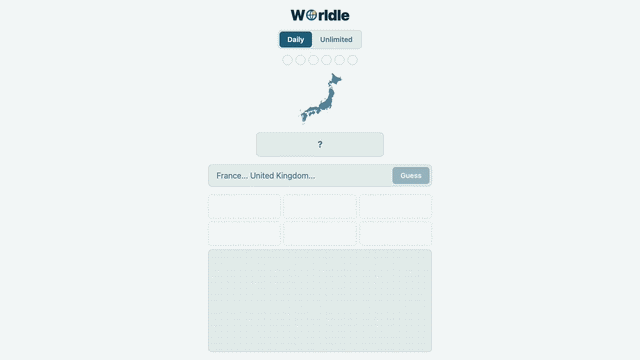
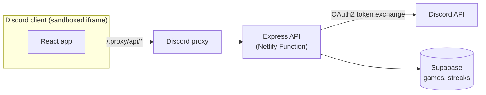

# Worldle Discord Activity

  

A daily country-guessing game that runs inside Discord as an Activity. Everyone gets the same mystery country outline each day. Every wrong guess shows how close you were and which way to go.

Obviously inspired by [Worldle](https://en.wikipedia.org/wiki/Worldle), but this game was not availble on Discord, so I thought to create it for people to enjoy on Discord, and that they can play with their friends.

Since I like to play this game as well, I wanted to add some features that I wanted for myself as well.

  

> **This is a showcase, not the full source.** It contains short snippets from a private repo, so it won't build or run on its own. If you'd like to see the full code for a job application or collaboration, open an issue and I can give you read access.

## Code highlights

Short snippets from the client, and the complete server files for one request, `GET /api/players`:

| File                                                            | What it shows                                                                   |
| --------------------------------------------------------------- | ------------------------------------------------------------------------------- |
| [`GameState.tsx`](client/src/context/GameState.tsx)             | Game state as a typed reducer: every action and status is a TypeScript union    |
| [`CountryList.tsx`](client/src/game/components/CountryList.tsx) | An accessible autocomplete with keyboard navigation, built with Floating UI     |
| [`Feedback.tsx`](client/src/game/components/Feedback.tsx)       | An in-game feedback form using the native `<dialog>` element and a typed status |
| [`app.ts`](server/src/app.ts)                                   | The Express app, with every route mounted under `/api`                          |
| [`routes.ts`](server/src/routes.ts)                             | Every API route, with auth middleware in front of the game endpoints            |
| [`middleware.ts`](server/src/http/middleware.ts)                | Bearer-token auth that returns a 401 or stores the user id for the handler      |
| [`validation.ts`](server/src/http/validation.ts)                | Joi schemas for every request body and query, including the player id list      |
| [`GameController.ts`](server/src/controllers/GameController.ts) | Load, save and players handlers; players get percentages, not guesses           |

## Features

| Feature                 | Description                                                              |
| ----------------------- | ------------------------------------------------------------------------ |
| Daily puzzle            | The same country for everyone, resetting at midnight UTC                 |
| Unlimited mode          | Practise with random countries at Easy, Moderate, Hard or All            |
| Proximity and direction | Each wrong guess shows a proximity % and an arrow pointing to the answer |
| Streaks                 | Current and best daily streaks, stored on the server                     |
| Saved progress          | Closing and reopening the Activity resumes today's game                  |
| Players bar             | See how others in the channel are doing, without seeing their guesses    |
| In-game feedback        | Players can report bugs from inside Discord                              |

## Tech stack

| Layer    | Technology                                                        |
| -------- | ----------------------------------------------------------------- |
| Client   | React 19, TypeScript, Vite, Tailwind CSS + daisyUI                |
| Discord  | Discord Embedded App SDK                                          |
| Server   | Express 5, running as a Netlify Function                          |
| Database | Supabase (Postgres)                                               |
| Map data | Pre-rendered SVG outline per country, preloaded before each round |
| Hosting  | Netlify                                                           |

## How it fits together

- Discord Activities run in a sandboxed iframe, so every request goes through Discord's proxy and URL mappings.
- The Discord client secret stays on the server. The client only ever gets the user's access token.
- Game rules and maths live in a shared TypeScript module, used by both the client and the server.

## Challenges I worked through

- **Auth inside an iframe.** Getting the Discord OAuth2 flow, token exchange and proxy URL mappings working together, both locally through a tunnel and in production.
- **Instant rounds.** Preloading each country's outline in the background, so the next round appears without a loading flash.
- **Fair daily resets.** Using one UTC-based seed for everyone, with a grace period so players who start just before midnight can still finish.
- **One codebase, two platforms.** A mobile-first layout that works in Discord on desktop and mobile, in both light and dark themes.
